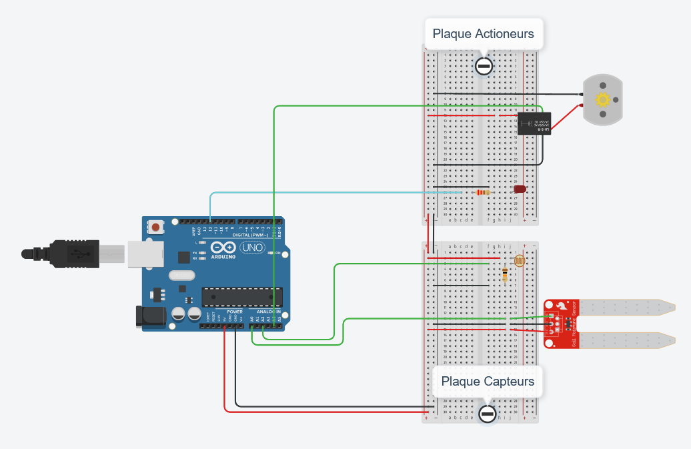

# Spooky
Spooky est un pot de fleurs connecté qui vous permet de surveiller votre plante. Vous pourrez la voir pousser et interagir avec elle.
Grâce à notre application, vous pouvez consulter le rapport sur l'état de santé de votre plante et déclencher certaines actions pour l'aider à pousser.

## Prérequis
Microcontroleur type ESP8266 (ex NodeMCU)

IDE Arduino 
https://www.arduino.cc/en/software

Extension pour esp8266 
https://arduino-esp8266.readthedocs.io/en/latest/installing.html

## Mis en route 
- Ouvrir le projet avec l'IDE Arduino
- Téléverser le code sur une carte
- Se connecter au hotspot wifi spooky
- Aller sur 192.168.4.1
- Entrer les informations de wifi
- Si tout se passe bien le hotspot disparait, les informations de connexion sont stocké dans la mémoire du microcontroleur

## Circuit électrique

## Vue 3D

